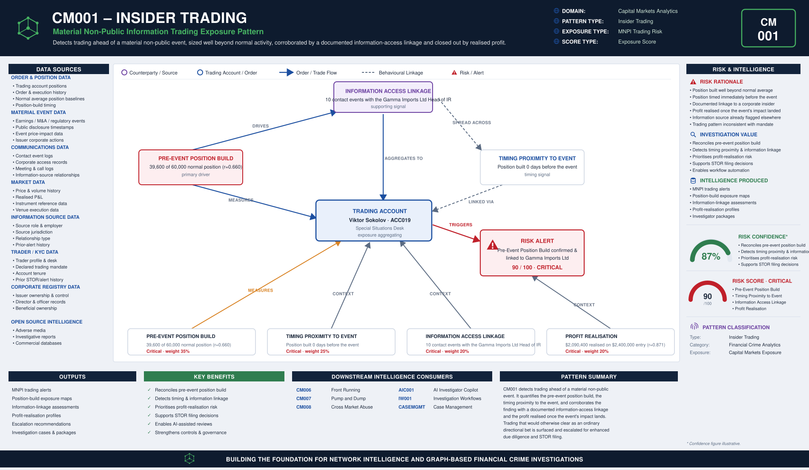

# CM001 – Insider Trading

## Typology Overview

Insider trading is dealing in a financial instrument while in possession of material
non-public information (MNPI) — an earnings release, an M&A announcement, a regulatory
decision — ahead of the event's public disclosure. The finding is a convergence
finding: it lives in how large the trader's position build is relative to their normal
activity, how close to the event the position was built, whether there is a documented
information-access linkage between the trader and a source with early knowledge, and
how much profit is realised once the event's price impact lands.

Article 8 of the EU Market Abuse Regulation (MAR) prohibits both dealing on inside
information and recommending or inducing another person to deal on it. Article 10
prohibits its unlawful disclosure. CM001 detects the trading-side signature of both.

---

# Typology Classification

| Attribute | Value |
|------------|------------|
| Typology ID | CM001 |
| Category | Insider Trading |
| Risk Domain | Capital Markets Surveillance |
| Primary Threat | Trading ahead of material non-public information |
| Detection Type | Position-build & timing-proximity analytics |
| Investigation Type | Insider Trading Investigation |
| Risk Level | High |

---

# Typology Description

Insider trading seeks to convert early, non-public knowledge of a price-moving event
into trading profit before the market can react, through:

- A position build materially larger than the trader's normal average position
- Timing concentrated in the days (or hours) immediately before the event
- A documented information-access linkage — contact events with a source who had
  early knowledge (a corporate insider, an advisor, a corporate-access contact)
- Profit realised once the event's price impact lands, closing the loop

---

# Typical Routing Structure

```text
Information Source  (corporate insider / advisor / corporate access contact)
       │
       ▼
Contact Events  (documented, in the 90 days before the event)   ← linkage established here
       │
       ▼
Trading Account  (position built well beyond normal average, timed close to the event)
       │
       ▼
Material Non-Public Event  (earnings, M&A, regulatory decision)
       │
       ▼
Profit Realised  (once the event's price impact lands)
```

---

# FC-03 Network Intelligence Dependencies

| FC-03 Component | Purpose |
|------------|------------|
| ER001 Entity Resolution | Resolve the trader, the issuer and the information source |
| RD001 Relationship Discovery | Link the trader to the information source and the issuer |
| NS001 Network Risk Scoring | Aggregate insider-trading exposure across the trader's connections |
| NI012 Behavioural Pattern Network | Position-build and contact-clustering behaviour |

---

# Key Risk Indicators

## Pre-Event Position Build Indicators
- Position build materially larger than the trader's normal average position
- Position sized and directed inconsistently with the trader's stated mandate
- Position concentrated in a single issuer or a small basket around one event

## Timing Proximity Indicators
- Position build concentrated in the days immediately before the event
- Order timing inconsistent with the trader's normal trading cadence

## Information Access Linkage Indicators
- Documented contact events with a corporate insider, advisor or corporate-access
  contact in the 90 days before the event
- Contact frequency inconsistent with the trader's normal coverage relationships
- Source has known access to the issuer's material non-public information

## Profit Realisation Indicators
- Realised profit disproportionate to the position's entry value once the event lands
- Profit timing tightly coupled to the event's public disclosure

---

# Exposure Scoring Framework

| Risk Category | Weight |
|------------|------------|
| Pre-Event Position Build | 35% |
| Timing Proximity to Event | 25% |
| Information Access Linkage | 20% |
| Profit Realisation | 20% |

Band-midpoints 15/45/70/90, weighted sum, half-up, boundary at 80.

## Component Banding Rules

### Pre-Event Position Build
`r = pre_event_position_increase / normal_average_position`. Both amounts REQUIRED.
- r < 0.10 → Low · r < 0.30 → Medium · r < 0.60 → High · otherwise → Critical

### Timing Proximity to Event
`days_before_event` REQUIRED — fewer days before the event is worse.
- ≤ 1 → Critical · ≤ 3 → High · ≤ 7 → Medium · otherwise (> 7) → Low

### Information Access Linkage
`contact_events_90d` REQUIRED — count of documented contact events with the
information source in the 90 days before the event.
- ≤ 2 → Low · ≤ 5 → Medium · ≤ 9 → High · otherwise (≥ 10) → Critical

### Profit Realisation
`r = realized_pnl / position_value_at_entry`. Both amounts REQUIRED.
- r < 0.25 → Low · r < 0.50 → Medium · r < 0.80 → High · otherwise → Critical

---

# Example Exposure Score — ACC019 Viktor Sokolov

| Component | Evidence | Band |
|------------|----------|------|
| Pre-Event Position Build | 39,600 of 60,000 normal average position (r = 0.660) | Critical |
| Timing Proximity to Event | Position built 0 days before the event | Critical |
| Information Access Linkage | 10 contact events with Marcus Webb, Gamma Imports Ltd's Head of IR, in the 90 days before the event | Critical |
| Profit Realisation | $2,090,400 realised on a $2,400,000 entry position (r = 0.871) | Critical |

**Total Exposure Score: 90 / 100 — Critical** (the single highest-scoring account in
the sample data)

### Classification
- 0–29 = Low · 30–59 = Medium · 60–79 = High · 80–100 = Critical

---

# Business Logic

1. Resolve the trader, the issuer and the information source.
2. Compute the pre-event position build ratio (position increase / normal average position).
3. Compute the timing proximity to the event (days before the event the position was built).
4. Count the documented contact events with the information source in the 90 days before the event.
5. Compute the profit realisation ratio (realised P&L / position value at entry).
6. Score each of the four components against its band cut-lines.
7. Aggregate the weighted exposure score; escalate at or above the threshold.

---

# Detection Workflow

```text
Order & Position Screening
       ↓
Pre-Event Position Build Calculation
       ↓
Timing Proximity Analysis
       ↓
Information Access Linkage Review
       ↓
Profit Realisation Assessment
       ↓
Exposure Scoring
       ↓
Investigator Escalation
```

---

# Python Analytics Example

```python
suspect = accounts[
    (accounts["pre_event_position_build_band"].isin(["High", "Critical"])) &
    (accounts["days_before_event"] <= 3) &
    (accounts["contact_events_90d"] >= 6)
]
alerts = suspect[suspect["exposure_score"] >= 80]
```

---

# Investigator Outcome

```text
Trader:                Viktor Sokolov — ACC019
Desk:                  Special Situations Desk
Issuer:                Gamma Imports Ltd
Normal Average Position: 60,000 units
Pre-Event Position Build: 39,600 units (r = 0.660), 0 days before the event
Information Source:    Marcus Webb (Gamma Imports Ltd, Head of Investor Relations)
Contact Events (90d):  10
Position Value at Entry: $2,400,000 → Realised P&L: $2,090,400 (r = 0.871)
Exposure Score:        90 / 100
Investigation Outcome:  Escalate — position built ahead of a material non-public
                         event, corroborated by a documented information-access
                         linkage to a corporate insider
```

---

# Regulatory Relevance

- EU Market Abuse Regulation (MAR) Article 8 — Insider Dealing
- EU Market Abuse Regulation (MAR) Article 10 — Unlawful Disclosure of Inside Information
- EU Market Abuse Regulation (MAR) Article 14 — Prohibition of Insider Dealing
- FCA Market Conduct Sourcebook (MAR 1) — UK insider dealing provisions
- US Securities Exchange Act of 1934, Section 10(b) and Rule 10b-5

---

# Related Typologies

- CM006 Front Running
- CM007 Pump and Dump
- CM008 Cross Market Abuse

---

# Strategic Value

CM001 shows how position-build and timing-proximity intelligence defeats information-
advantage trading: by quantifying the pre-event position build, the timing proximity to
the event, the documented information-access linkage, and the profit realised once the
event lands, it surfaces trading that has been deliberately timed to exploit material
non-public information and would otherwise clear as an ordinary directional bet. As the
reference typology for the fc-07 Capital Markets Analytics family, its file set,
scoring convention, and fc-10 wiring pattern are what every subsequent CM00N typology
replicates.


