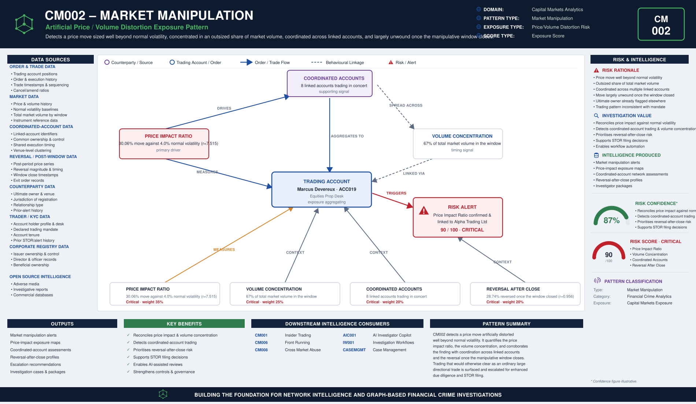

# CM002 – Market Manipulation

## Typology Overview

Market manipulation is the artificial distortion of a security's price or volume to
create a false or misleading impression of supply, demand, or price, so a position can
be exited — or a benchmark can be gamed — at an advantage. The finding is a convergence
finding: it lives in how large the price move is relative to the instrument's normal
volatility, how concentrated the account's footprint is against total market volume,
whether the trading is coordinated across linked accounts, and how much of the price
move reverses once the manipulative window closes — the tell that the move was not
information-driven.

Article 12 of the EU Market Abuse Regulation (MAR) defines market manipulation. Article
15 prohibits it outright. CM002 detects the trading-side signature of both.

---

# Typology Classification

| Attribute | Value |
|------------|------------|
| Typology ID | CM002 |
| Category | Market Manipulation |
| Risk Domain | Capital Markets Surveillance |
| Primary Threat | Artificial price/volume distortion to create a false market impression |
| Detection Type | Price-impact & reversal analytics |
| Investigation Type | Market Manipulation Investigation |
| Risk Level | High |

---

# Typology Description

Market manipulation seeks to convert a manufactured price or volume signal into trading
profit before the market corrects, through:

- A price move materially larger than the instrument's normal volatility
- A trading footprint that is an outsized share of total market volume in the window
- Coordination across linked accounts trading in concert to amplify the move
- A reversal of the price move once the manipulative window closes, closing the loop

---

# Typical Routing Structure

```text
Coordinated Accounts  (linked accounts trading in concert)   ← coordination established here
       │
       ▼
Trading Account  (price move built well beyond normal volatility)
       │
       ▼
Concentrated Market Volume  (outsized share of total market volume in the window)
       │
       ▼
Manipulative Window Closes
       │
       ▼
Price Reversal  (the move largely unwinds -- proof it was not information-driven)
```

---

# FC-03 Network Intelligence Dependencies

| FC-03 Component | Purpose |
|------------|------------|
| ER001 Entity Resolution | Resolve the account holder, the ultimate owner and the venue |
| RD001 Relationship Discovery | Link the account to coordinated accounts and the ultimate owner |
| NS001 Network Risk Scoring | Aggregate market-manipulation exposure across coordinated accounts |
| NI012 Behavioural Pattern Network | Coordinated-trading and volume-clustering behaviour |

---

# Key Risk Indicators

## Price Impact Ratio Indicators
- Price move materially larger than the instrument's normal volatility
- Move concentrated in a short surveillance window rather than a sustained trend
- Move inconsistent with any contemporaneous public news or disclosure

## Volume Concentration Indicators
- Account share of total market volume disproportionate to its normal trading pattern
- Volume concentrated in a thin or illiquid instrument
- Order flow inconsistent with the account's stated trading mandate

## Coordinated Accounts Indicators
- Multiple accounts trading in concert, in the same direction, in the same window
- Linked accounts sharing common beneficial ownership, venue, or execution timing
- Coordination frequency inconsistent with independent trading decisions

## Reversal After Close Indicators
- Price move largely unwinds once the manipulative window closes
- Reversal timing tightly coupled to the account's own exit, not to any market news
- Reversal magnitude disproportionate to the size of the original move

---

# Exposure Scoring Framework

| Risk Category | Weight |
|------------|------------|
| Price Impact Ratio | 35% |
| Volume Concentration | 25% |
| Coordinated Accounts | 20% |
| Reversal After Close | 20% |

Band-midpoints 15/45/70/90, weighted sum, half-up, boundary at 80.

## Component Banding Rules

### Price Impact Ratio
`r = price_move_pct / normal_volatility_pct`. Both amounts REQUIRED.
- r < 1.5 → Low · r < 3.0 → Medium · r < 6.0 → High · otherwise → Critical

### Volume Concentration
`pct_of_market_volume` REQUIRED — the account's share of total market volume in the
surveillance window.
- ≤ 10 → Low · ≤ 25 → Medium · ≤ 45 → High · otherwise (> 45) → Critical

### Coordinated Accounts
`linked_accounts_count` REQUIRED — count of accounts trading in concert.
- ≤ 1 → Low · = 2 → Medium · ≤ 4 → High · otherwise (≥ 5) → Critical

### Reversal After Close
`r = post_period_reversal_pct / price_move_pct`. Both amounts REQUIRED.
- r < 0.25 → Low · r < 0.50 → Medium · r < 0.80 → High · otherwise → Critical

---

# Example Exposure Score — ACC019 Marcus Kettlebutton

| Component | Evidence | Band |
|------------|----------|------|
| Price Impact Ratio | 30.06% price move against 4.0% normal volatility (r = 7.515) | Critical |
| Volume Concentration | 67% of total market volume in the surveillance window | Critical |
| Coordinated Accounts | 8 linked accounts trading in concert | Critical |
| Reversal After Close | 28.74% of the price move reversed once the window closed (r = 0.956) | Critical |

**Total Exposure Score: 90 / 100 — Critical** (the single highest-scoring account in
the sample data)

### Classification
- 0–29 = Low · 30–59 = Medium · 60–79 = High · 80–100 = Critical

---

# Business Logic

1. Resolve the account holder, the ultimate owner and the venue.
2. Compute the price impact ratio (price move % / normal volatility %).
3. Compute the volume concentration (account share of total market volume in the window).
4. Count the linked accounts trading in concert with this account.
5. Compute the reversal-after-close ratio (post-period reversal % / price move %).
6. Score each of the four components against its band cut-lines.
7. Aggregate the weighted exposure score; escalate at or above the threshold.

---

# Detection Workflow

```text
Order & Trade Screening
       ↓
Price Impact Ratio Calculation
       ↓
Volume Concentration Analysis
       ↓
Coordinated-Account Review
       ↓
Reversal-After-Close Assessment
       ↓
Exposure Scoring
       ↓
Investigator Escalation
```

---

# Python Analytics Example

```python
suspect = accounts[
    (accounts["price_impact_ratio_band"].isin(["High", "Critical"])) &
    (accounts["pct_of_market_volume"] >= 25) &
    (accounts["linked_accounts_count"] >= 3)
]
alerts = suspect[suspect["exposure_score"] >= 80]
```

---

# Investigator Outcome

```text
Account Holder:        Marcus Kettlebutton — ACC019
Desk:                  Equities Prop Desk
Instrument:            Alpha Trading Ltd Ordinary Shares
Normal Volatility:     4.0%
Price Move:            30.06% (r = 7.515)
Volume Concentration:  67% of total market volume
Coordinated Accounts:  8 linked accounts trading in concert
Reversal After Close:  28.74% reversed (r = 0.956)
Ultimate Owner:        Alpha Trading Ltd
Exposure Score:        90 / 100
Investigation Outcome:  Escalate — price artificially distorted well beyond normal
                         volatility on an outsized share of market volume, coordinated
                         across linked accounts, and largely unwound once the window
                         closed
```

---

# Regulatory Relevance

- EU Market Abuse Regulation (MAR) Article 12 — Market Manipulation
- EU Market Abuse Regulation (MAR) Article 15 — Prohibition of Market Manipulation
- EU Market Abuse Regulation (MAR) Annex I Section A/B — Indicators of Manipulative Behaviour
- FCA Market Conduct Sourcebook (MAR 1) — UK market manipulation provisions

---

# Related Typologies

- CM001 Insider Trading
- CM006 Front Running
- CM008 Cross Market Abuse

---

# Strategic Value

CM002 shows how price-impact and reversal intelligence defeats artificial price and
volume distortion: by quantifying the price impact ratio, the volume concentration, the
coordination across linked accounts, and the reversal once the manipulative window
closes, it surfaces trading that has been deliberately engineered to create a false
market impression and would otherwise clear as an ordinary large directional trade. As
the second typology in the fc-07 Capital Markets Analytics family, its file set,
scoring convention, and fc-10 wiring pattern replicate CM001's, matching the house
pattern every subsequent CM00N typology follows.


