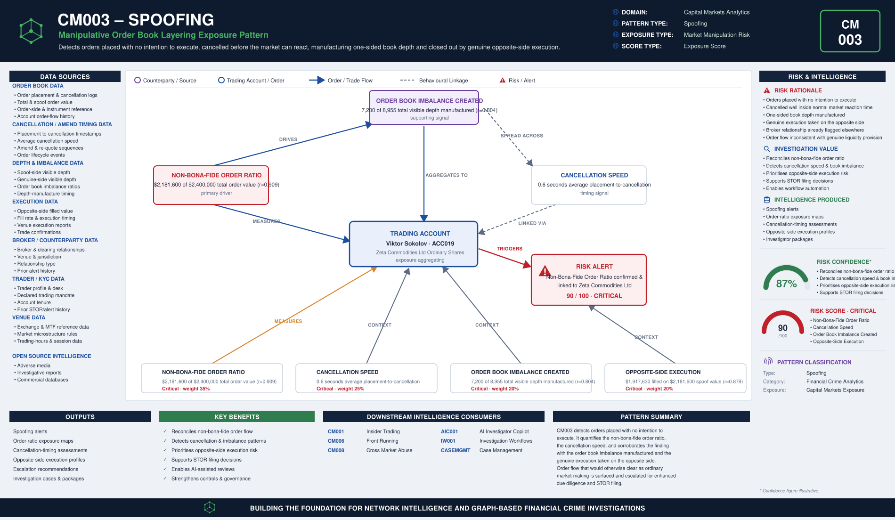

# CM003 – Spoofing

## Typology Overview

Spoofing is placing orders on one side of an order book with no intention of letting
them execute, in order to move the visible order book and induce other participants to
trade at a manipulated price, then cancelling the spoof orders and executing genuine
trades on the opposite side once the market has reacted. The finding is a convergence
finding: it lives in how large a share of order value is never genuinely intended to
execute, how fast those orders are cancelled before the market can treat them as real,
how much visible depth on one side the spoof orders manufacture, and how much genuine
execution happens on the opposite side while the spoof orders are working.

Article 12(1)(a)(ii) of the EU Market Abuse Regulation (MAR) prohibits placing orders
with no intention of executing them where they give, or are likely to give, false or
misleading signals as to the supply of, demand for, or price of a financial instrument.
CM003 detects the order-flow signature of this behaviour.

---

# Typology Classification

| Attribute | Value |
|------------|------------|
| Typology ID | CM003 |
| Category | Spoofing |
| Risk Domain | Capital Markets Surveillance |
| Primary Threat | Manipulative order-book layering to induce false price signals |
| Detection Type | Order-flow & cancellation-timing analytics |
| Investigation Type | Market Manipulation Investigation |
| Risk Level | High |

---

# Typology Description

Spoofing seeks to convert a manufactured order book into trading profit before the
market corrects, through:

- A non-bona-fide order ratio materially larger than genuine order flow would produce
- Cancellation concentrated in the seconds immediately after placement — before the
  market can treat the orders as real
- A documented order book imbalance — the spoof orders manufacturing depth on one side
  well beyond what genuine liquidity would show
- Genuine execution on the opposite side while the spoof orders are working, closing
  the loop

---

# Typical Routing Structure

```text
Trading Account  (order flow across an instrument and venue)
       │
       ▼
Spoof Orders Placed  (one side of the book, no intention to execute)   ← manipulation begins here
       │
       ▼
Order Book Imbalance Created  (visible depth manufactured on one side)
       │
       ▼
Opposite-Side Execution  (genuine trades taken while the book is skewed)
       │
       ▼
Spoof Orders Cancelled  (before the market can treat them as real)
       │
       ▼
Broker / Venue  (routes and clears the account's order flow)
```

---

# FC-03 Network Intelligence Dependencies

| FC-03 Component | Purpose |
|------------|------------|
| ER001 Entity Resolution | Resolve the trader, the broker and the venue |
| RD001 Relationship Discovery | Link the trading account to its broker and clearing relationships |
| NS001 Network Risk Scoring | Aggregate spoofing exposure across the trader's connections |
| NI012 Behavioural Pattern Network | Order-placement and cancellation-clustering behaviour |

---

# Key Risk Indicators

## Non-Bona-Fide Order Ratio Indicators
- Order value materially larger than the trader's genuine execution history would predict
- Orders sized and directed to move the visible book rather than to execute
- Order flow concentrated in a single instrument or a small basket around one venue

## Cancellation Speed Indicators
- Orders cancelled within seconds of placement, well inside normal market reaction time
- Cancellation timing inconsistent with the trader's normal order-management cadence

## Order Book Imbalance Created Indicators
- Spoof orders manufacturing a majority share of visible depth on one side
- Depth imbalance inconsistent with genuine two-sided liquidity provision
- Imbalance timed to coincide with opposite-side execution

## Opposite-Side Execution Indicators
- Genuine execution disproportionate to normal fill rates while the book is skewed
- Execution timing tightly coupled to the spoof orders' cancellation

---

# Exposure Scoring Framework

| Risk Category | Weight |
|------------|------------|
| Non-Bona-Fide Order Ratio | 35% |
| Cancellation Speed | 25% |
| Order Book Imbalance Created | 20% |
| Opposite-Side Execution | 20% |

Band-midpoints 15/45/70/90, weighted sum, half-up, boundary at 80.

## Component Banding Rules

### Non-Bona-Fide Order Ratio
`r = spoof_order_value / total_order_value`. Both amounts REQUIRED.
- r < 0.10 → Low · r < 0.30 → Medium · r < 0.60 → High · otherwise → Critical

### Cancellation Speed
`avg_cancel_seconds` REQUIRED — average time from placement to cancellation. Smaller is
worse (fast cancellation before execution is the spoofing tell).
- ≤ 2 → Critical · ≤ 5 → High · ≤ 15 → Medium · otherwise (> 15) → Low

### Order Book Imbalance Created
`r = spoof_side_depth / (spoof_side_depth + genuine_side_depth)`. Both amounts
REQUIRED — the share of visible depth the spoof orders create on one side.
- r < 0.10 → Low · r < 0.30 → Medium · r < 0.60 → High · otherwise → Critical

### Opposite-Side Execution
`r = opposite_side_filled_value / spoof_order_value`. Both amounts REQUIRED — how much
genuine execution happens on the opposite side while spoofing.
- r < 0.25 → Low · r < 0.50 → Medium · r < 0.80 → High · otherwise → Critical

---

# Example Exposure Score — ACC019 Viktor Flintquill

| Component | Evidence | Band |
|------------|----------|------|
| Non-Bona-Fide Order Ratio | $2,181,600 of $2,400,000 total order value (r = 0.909) | Critical |
| Cancellation Speed | 0.6 seconds average time from placement to cancellation | Critical |
| Order Book Imbalance Created | 7,200 of 8,955 total visible depth manufactured on one side (r = 0.804) | Critical |
| Opposite-Side Execution | $1,917,630 filled on the opposite side against a $2,181,600 spoof order value (r = 0.879) | Critical |

**Total Exposure Score: 90 / 100 — Critical** (the single highest-scoring account in
the sample data)

### Classification
- 0–29 = Low · 30–59 = Medium · 60–79 = High · 80–100 = Critical

---

# Business Logic

1. Resolve the trading account, its broker and the instrument traded.
2. Compute the non-bona-fide order ratio (spoof order value / total order value).
3. Compute the average cancellation speed (average seconds from placement to cancellation).
4. Compute the order book imbalance created (spoof-side depth / total visible depth).
5. Compute the opposite-side execution ratio (opposite-side filled value / spoof order value).
6. Score each of the four components against its band cut-lines.
7. Aggregate the weighted exposure score; escalate at or above the threshold.

---

# Detection Workflow

```text
Order & Cancellation Screening
       ↓
Non-Bona-Fide Order Ratio Calculation
       ↓
Cancellation Speed Analysis
       ↓
Order Book Imbalance Review
       ↓
Opposite-Side Execution Assessment
       ↓
Exposure Scoring
       ↓
Investigator Escalation
```

---

# Python Analytics Example

```python
suspect = orders[
    (orders["non_bona_fide_order_ratio_band"].isin(["High", "Critical"])) &
    (orders["avg_cancel_seconds"] <= 5) &
    (orders["order_book_imbalance_created_band"].isin(["High", "Critical"]))
]
alerts = suspect[suspect["exposure_score"] >= 80]
```

---

# Investigator Outcome

```text
Trader:                Viktor Flintquill — ACC019
Instrument:            Zeta Commodities Ltd Ordinary Shares
Broker:                Zeta Commodities Ltd
Total Order Value:     $2,400,000
Spoof Order Value:     $2,181,600 (r = 0.909)
Cancellation Speed:    0.6 seconds average
Order Book Imbalance:  7,200 of 8,955 total depth manufactured (r = 0.804)
Opposite-Side Execution: $1,917,630 filled against $2,181,600 spoof value (r = 0.879)
Exposure Score:        90 / 100
Investigation Outcome:  Escalate — order book manufactured with no intention to
                         execute, cancelled before the market could react, and
                         genuine execution taken on the opposite side
```

---

# Regulatory Relevance

- EU Market Abuse Regulation (MAR) Article 12(1)(a)(ii) — Orders placed with no
  intention to execute
- EU Market Abuse Regulation (MAR) Annex II / ESMA Guidelines on indicators of
  manipulative behaviour
- FCA Market Conduct Sourcebook (MAR 1) — UK market manipulation provisions

---

# Related Typologies

- CM001 Insider Trading
- CM006 Front Running
- CM008 Cross Market Abuse

---

# Strategic Value

CM003 shows how order-flow and cancellation-timing intelligence defeats manufactured
liquidity: by quantifying the non-bona-fide order ratio, the cancellation speed, the
order book imbalance created, and the genuine execution taken on the opposite side, it
surfaces order flow that has been deliberately shaped to move the visible book and would
otherwise clear as ordinary market-making activity. As a core detection pattern in the
fc-07 Capital Markets Analytics family, it mirrors CM001's file set, scoring convention,
and fc-10 wiring pattern so that market-manipulation exposure is scored on the same
governed basis as every other typology in the estate.


