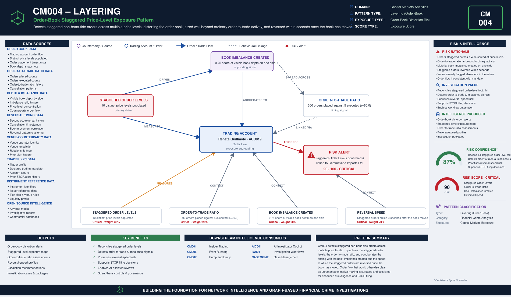

# CM004 – Layering

## Typology Overview

This is ORDER-BOOK layering — staggering non-bona-fide orders across multiple price
levels on one side of the book to create a false impression of depth or intent, moving
the price or inducing other participants to trade against it, then cancelling the
staggered orders before they are ever meant to execute. It is distinct from the AML
"layering" typology, which moves illicit funds through successive transactions to
obscure their origin; CM004 is a market-abuse pattern in the order book, not a money-
laundering placement/layering/integration stage. The finding is a convergence finding:
it lives in how many distinct price levels the staggered orders sit at, how
disproportionate the order-to-trade ratio is (orders placed vs. ever executed), how
much visible book depth/imbalance the staggering creates on one side, and how quickly
the staggered orders are reversed once the book has moved.

Article 12(1)(a) of the EU Market Abuse Regulation (MAR) prohibits placing orders that
give, or are likely to give, false or misleading signals as to the supply, demand or
price of a financial instrument. CM004 detects the order-book signature of layering and
spoofing behaviour.

---

# Typology Classification

| Attribute | Value |
|------------|------------|
| Typology ID | CM004 |
| Category | Layering (Order-Book) |
| Risk Domain | Capital Markets Surveillance |
| Primary Threat | Staggered non-bona-fide orders distorting the order book |
| Detection Type | Order-book distortion & reversal-timing analytics |
| Investigation Type | Market Manipulation Investigation |
| Risk Level | High |

---

# Typology Description

Order-book layering seeks to move price or induce other participants to trade by
creating a false impression of book depth, through:

- Staggered orders sitting at a materially wide spread of distinct price levels
- An order-to-trade ratio far beyond ordinary market-making or execution activity
- Visible book imbalance created on one side of the book by the staggered orders
- Rapid reversal (cancellation) of the staggered orders once the book has moved,
  closing the loop before any of them were meant to execute

---

# Typical Routing Structure

```text
Trading Account  (staggers non-bona-fide orders across multiple price levels)
       │
       ▼
Order Book  (distinct price levels populated; visible depth skewed on one side)   ← imbalance created here
       │
       ▼
Order-to-Trade Ratio  (orders placed vastly exceed orders ever executed)
       │
       ▼
Market Reaction  (price moves, or other participants trade against the imbalance)
       │
       ▼
Reversal  (staggered orders pulled within seconds of the book moving)
```

---

# FC-03 Network Intelligence Dependencies

| FC-03 Component | Purpose |
|------------|------------|
| ER001 Entity Resolution | Resolve the trader, the venue operator and the instrument |
| RD001 Relationship Discovery | Link the trader to the venue and prior alert history |
| NS001 Network Risk Scoring | Aggregate layering exposure across the trader's connections |
| NI012 Behavioural Pattern Network | Order-placement and reversal-timing behaviour |

---

# Key Risk Indicators

## Staggered Order Levels Indicators
- Orders staggered across a materially wide spread of distinct price levels
- Order-book footprint inconsistent with the trader's stated mandate
- Level distribution concentrated in a single instrument or venue

## Order-to-Trade Ratio Indicators
- Orders placed far exceeding orders ever executed
- Order flow inconsistent with the trader's normal order-to-trade profile
- Order cadence timed to precede price movement rather than to trade

## Book Imbalance Created Indicators
- A material share of visible book depth created on one side by the staggered orders
- Imbalance timed to coincide with other participants' order flow
- Imbalance disproportionate to the trader's genuine position objective

## Reversal Speed Indicators
- Staggered orders pulled within seconds of the book moving
- Reversal timing tightly coupled to a price move or a counterparty's response
- Cancellation pattern inconsistent with genuine liquidity provision

---

# Exposure Scoring Framework

| Risk Category | Weight |
|------------|------------|
| Staggered Order Levels | 35% |
| Order-to-Trade Ratio | 25% |
| Book Imbalance Created | 20% |
| Reversal Speed | 20% |

Band-midpoints 15/45/70/90, weighted sum, half-up, boundary at 80.

## Component Banding Rules

### Staggered Order Levels
`distinct_price_levels` REQUIRED — count of distinct price levels the staggered
orders sit at.
- ≤ 2 → Low · ≤ 4 → Medium · ≤ 7 → High · otherwise (≥ 8) → Critical

### Order-to-Trade Ratio
`r = orders_placed / orders_executed`. Both amounts REQUIRED, `orders_executed` > 0.
- r < 5 → Low · r < 15 → Medium · r < 40 → High · otherwise → Critical

### Book Imbalance Created
`imbalance_ratio` REQUIRED — the share of visible book depth the staggered orders
create on one side.
- r < 0.10 → Low · r < 0.30 → Medium · r < 0.60 → High · otherwise → Critical

### Reversal Speed
`seconds_to_reversal` REQUIRED — how quickly the staggered orders are pulled once the
book has moved. Smaller is WORSE.
- ≤ 5 → Critical · ≤ 20 → High · ≤ 60 → Medium · otherwise (> 60) → Low

---

# Example Exposure Score — ACC019 Renata Quillmote

| Component | Evidence | Band |
|------------|----------|------|
| Staggered Order Levels | 10 distinct price levels populated | Critical |
| Order-to-Trade Ratio | 300 orders placed against 5 executed (r = 60.0) | Critical |
| Book Imbalance Created | 0.75 share of visible book depth created on one side | Critical |
| Reversal Speed | Staggered orders pulled 3 seconds after the book moved | Critical |

**Total Exposure Score: 90 / 100 — Critical** (the single highest-scoring account in
the sample data)

### Classification
- 0–29 = Low · 30–59 = Medium · 60–79 = High · 80–100 = Critical

---

# Business Logic

1. Resolve the trader, the venue operator and the instrument.
2. Count the distinct price levels the staggered orders sit at.
3. Compute the order-to-trade ratio (orders placed / orders executed).
4. Compute the share of visible book depth the staggered orders create on one side.
5. Compute the reversal speed (seconds elapsed before the staggered orders are pulled).
6. Score each of the four components against its band cut-lines.
7. Aggregate the weighted exposure score; escalate at or above the threshold.

---

# Detection Workflow

```text
Order Book Screening
       ↓
Staggered Order Level Calculation
       ↓
Order-to-Trade Ratio Analysis
       ↓
Book Imbalance Review
       ↓
Reversal Speed Assessment
       ↓
Exposure Scoring
       ↓
Investigator Escalation
```

---

# Python Analytics Example

```python
suspect = orders[
    (orders["staggered_order_levels_band"].isin(["High", "Critical"])) &
    (orders["orders_placed"] / orders["orders_executed"] >= 15) &
    (orders["seconds_to_reversal"] <= 20)
]
alerts = suspect[suspect["exposure_score"] >= 80]
```

---

# Investigator Outcome

```text
Trader:                Renata Quillmote — ACC019
Instrument:            Gammavane Imports Ltd 4.5% 2029 Conv Bond
Venue Operator:        Gammavane Imports Ltd
Distinct Price Levels: 10
Orders Placed / Executed: 300 / 5 (r = 60.0)
Book Imbalance Created: 0.75
Seconds to Reversal:    3
Exposure Score:        90 / 100
Investigation Outcome:  Escalate — staggered non-bona-fide orders distorted the order
                         book and were reversed within seconds of the book moving
```

---

# Regulatory Relevance

- EU Market Abuse Regulation (MAR) Article 12(1)(a) — Order-Book Distortion / Layering
- MAR Annex II / ESMA Guidelines on Indicators of Manipulative Behaviour — layering and
  spoofing listed as a distinct indicator from wash trading
- FCA Market Conduct Sourcebook (MAR 1) — UK market manipulation provisions

---

# Related Typologies

- CM001 Insider Trading
- CM006 Front Running
- CM007 Pump and Dump

---

# Strategic Value

CM004 shows how order-book distortion intelligence defeats staggered non-bona-fide
order flow: by quantifying the staggered order levels, the order-to-trade ratio, the
book imbalance created, and the reversal speed once the book has moved, it surfaces
order flow that has been deliberately staged to move price or induce other
participants to trade, and would otherwise clear as unremarkable market-making or
liquidity-testing activity. As a member of the fc-07 Capital Markets Analytics family,
its file set, scoring convention, and fc-10 wiring pattern follow the CM001 reference
typology exactly.


