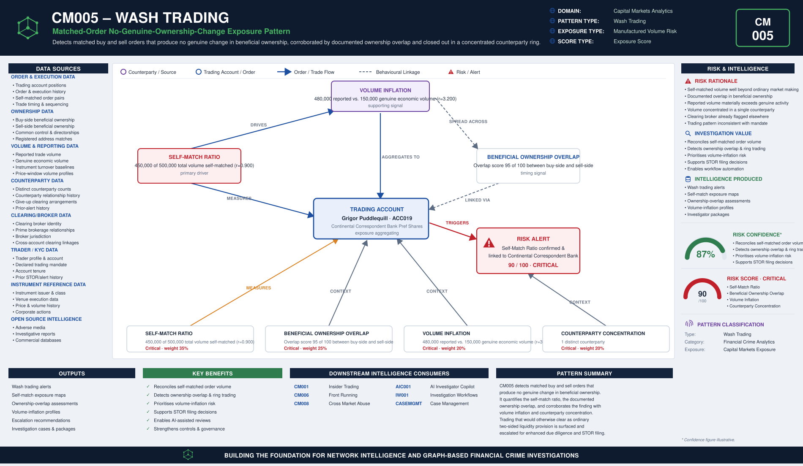

# CM005 – Wash Trading

## Typology Overview

Wash trading is trading that produces no genuine change in beneficial ownership —
matched buy and sell orders crossed against each other, directly or through a small,
concentrated ring of counterparties, to manufacture volume, mark a price, or create a
misleading impression of liquidity or interest in an instrument. The finding is a
convergence finding: it lives in how much of the account's own volume matches against
its own opposing orders, whether the buy-side and sell-side beneficial ownership
overlaps, how much reported volume exceeds the volume genuinely changing hands, and how
concentrated the trading is in a small number of distinct counterparties.

Article 12(1)(a)(i) of the EU Market Abuse Regulation (MAR) identifies wash trades and
matched orders that give false or misleading signals as to the supply, demand or price
of a financial instrument as market manipulation. CM005 detects the trading-side
signature of that manipulation.

---

# Typology Classification

| Attribute | Value |
|------------|------------|
| Typology ID | CM005 |
| Category | Wash Trading |
| Risk Domain | Capital Markets Surveillance |
| Primary Threat | Matched trading with no genuine change in beneficial ownership |
| Detection Type | Self-match & ownership-overlap analytics |
| Investigation Type | Wash Trading Investigation |
| Risk Level | High |

---

# Typology Description

Wash trading seeks to manufacture the appearance of genuine market activity — volume,
liquidity, or price — without any real transfer of economic risk, through:

- A self-match ratio materially larger than would occur from ordinary two-sided market
  making
- Documented overlap in beneficial ownership between the buy-side and sell-side of the
  trade
- Reported volume materially inflated relative to the volume that reflects genuine
  economic activity
- Trading concentrated in a small number of distinct counterparties — the fewer the
  counterparties, the more likely the trades are being crossed within a controlled ring

---

# Typical Routing Structure

```text
Trading Account  (self-matched buy & sell orders, concentrated counterparties)
       │
       ▼
Beneficial Ownership Overlap  (buy-side and sell-side share common control)   ← linkage established here
       │
       ▼
Matched / Crossed Orders  (reported volume exceeds genuine economic volume)
       │
       ▼
Clearing / Broker  (clears the matched legs, sees both sides of the ring)
       │
       ▼
Manufactured Volume / Price Signal  (misleading impression of liquidity or interest)
```

---

# FC-03 Network Intelligence Dependencies

| FC-03 Component | Purpose |
|------------|------------|
| ER001 Entity Resolution | Resolve the trader, the clearing broker and the counterparties |
| RD001 Relationship Discovery | Link the buy-side and sell-side beneficial ownership |
| NS001 Network Risk Scoring | Aggregate wash-trading exposure across the trader's connections |
| NI012 Behavioural Pattern Network | Self-match and counterparty-concentration clustering behaviour |

---

# Key Risk Indicators

## Self-Match Ratio Indicators
- Self-matched volume materially larger than would occur from ordinary market making
- Buy and sell orders entered in close time proximity at matching size and price
- Self-matching pattern inconsistent with the account's stated trading strategy

## Beneficial Ownership Overlap Indicators
- Documented overlap between the buy-side and sell-side beneficial ownership
- Common control, common directors, or common registered address across counterparties
- Overlap inconsistent with an arm's-length trading relationship

## Volume Inflation Indicators
- Reported volume materially exceeding the volume reflecting genuine economic activity
- Volume inflation concentrated around price-sensitive windows (close, index inclusion)
- Reporting inconsistent with the instrument's normal turnover profile

## Counterparty Concentration Indicators
- Volume concentrated in one or two distinct counterparties
- Counterparty concentration inconsistent with the account's normal execution spread
- Counterparties clearing through a shared broker with no independent price discovery

---

# Exposure Scoring Framework

| Risk Category | Weight |
|------------|------------|
| Self-Match Ratio | 35% |
| Beneficial Ownership Overlap | 25% |
| Volume Inflation | 20% |
| Counterparty Concentration | 20% |

Band-midpoints 15/45/70/90, weighted sum, half-up, boundary at 80.

## Component Banding Rules

### Self-Match Ratio
`r = self_matched_volume / total_volume`. Both amounts REQUIRED.
- r < 0.10 → Low · r < 0.30 → Medium · r < 0.60 → High · otherwise → Critical

### Beneficial Ownership Overlap
`overlap_score` (0-100) REQUIRED — documented overlap between the buy-side and
sell-side beneficial ownership.
- ≤ 20 → Low · ≤ 50 → Medium · ≤ 80 → High · otherwise (> 80) → Critical

### Volume Inflation
`r = reported_volume / genuine_economic_volume`. Both amounts REQUIRED.
- r < 1.2 → Low · r < 1.5 → Medium · r < 2.5 → High · otherwise → Critical

### Counterparty Concentration
`distinct_counterparties` REQUIRED — how many distinct counterparties the volume
trades against. FEWER is WORSE: concentration in one or two counterparties is the
wash-trading tell, so this component's banding is inverted relative to the other three.
- ≤ 1 → Critical · ≤ 2 → High · ≤ 4 → Medium · otherwise (≥ 5) → Low

---

# Example Exposure Score — ACC019 Grigor Puddlequill

| Component | Evidence | Band |
|------------|----------|------|
| Self-Match Ratio | 450,000 of 500,000 total volume self-matched (r = 0.900) | Critical |
| Beneficial Ownership Overlap | Overlap score 95 of 100 between buy-side and sell-side | Critical |
| Volume Inflation | 480,000 reported vs. 150,000 genuine economic volume (r = 3.200) | Critical |
| Counterparty Concentration | 1 distinct counterparty | Critical |

**Total Exposure Score: 90 / 100 — Critical** (the single highest-scoring account in
the sample data)

### Classification
- 0–29 = Low · 30–59 = Medium · 60–79 = High · 80–100 = Critical

---

# Business Logic

1. Resolve the trading account, the clearing broker and the counterparties.
2. Compute the self-match ratio (self-matched volume / total volume).
3. Assess the documented beneficial ownership overlap between the buy-side and sell-side.
4. Compute the volume inflation ratio (reported volume / genuine economic volume).
5. Count the distinct counterparties the volume trades against.
6. Score each of the four components against its band cut-lines.
7. Aggregate the weighted exposure score; escalate at or above the threshold.

---

# Detection Workflow

```text
Order & Execution Screening
       ↓
Self-Match Ratio Calculation
       ↓
Beneficial Ownership Overlap Review
       ↓
Volume Inflation Assessment
       ↓
Counterparty Concentration Analysis
       ↓
Exposure Scoring
       ↓
Investigator Escalation
```

---

# Python Analytics Example

```python
suspect = trades[
    (trades["self_match_ratio_band"].isin(["High", "Critical"])) &
    (trades["distinct_counterparties"] <= 2) &
    (trades["overlap_score"] >= 55)
]
alerts = suspect[suspect["exposure_score"] >= 80]
```

---

# Investigator Outcome

```text
Trader:                 Grigor Puddlequill — ACC019
Instrument:             Continental Correspondent Bank Pref Shares
Total Volume:           500,000 units
Self-Matched Volume:    450,000 units (r = 0.900)
Beneficial Ownership Overlap: 95 / 100
Reported vs. Genuine:   480,000 reported vs. 150,000 genuine (r = 3.200)
Distinct Counterparties: 1
Clearing Broker:        Continental Correspondent Bank
Exposure Score:         90 / 100
Investigation Outcome:   Escalate — matched orders produce no genuine change in
                          beneficial ownership, concentrated in a single
                          counterparty relationship
```

---

# Regulatory Relevance

- EU Market Abuse Regulation (MAR) Article 12(1)(a)(i) — Wash Trades and Matched Orders
- EU Market Abuse Regulation (MAR) Annex II — Indicators of Manipulative Behaviour
- US Commodity Exchange Act — Wash-Trading Prohibitions (analogous cross-reference)
- FCA Market Conduct Sourcebook (MAR 1) — UK market manipulation provisions

---

# Related Typologies

- CM001 Insider Trading
- CM006 Front Running
- CM008 Cross Market Abuse

---

# Strategic Value

CM005 shows how self-match and ownership-overlap intelligence defeats manufactured
market activity: by quantifying the self-match ratio, the documented beneficial
ownership overlap, the volume inflation relative to genuine economic activity, and the
concentration of trading in a small ring of counterparties, it surfaces matched trading
that would otherwise clear as ordinary two-sided liquidity provision. As a member of the
fc-07 Capital Markets Analytics family, it follows CM001's file set, scoring convention,
and fc-10 wiring pattern exactly, keeping wash-trading surveillance on the same governed
substrate as the rest of the estate.


