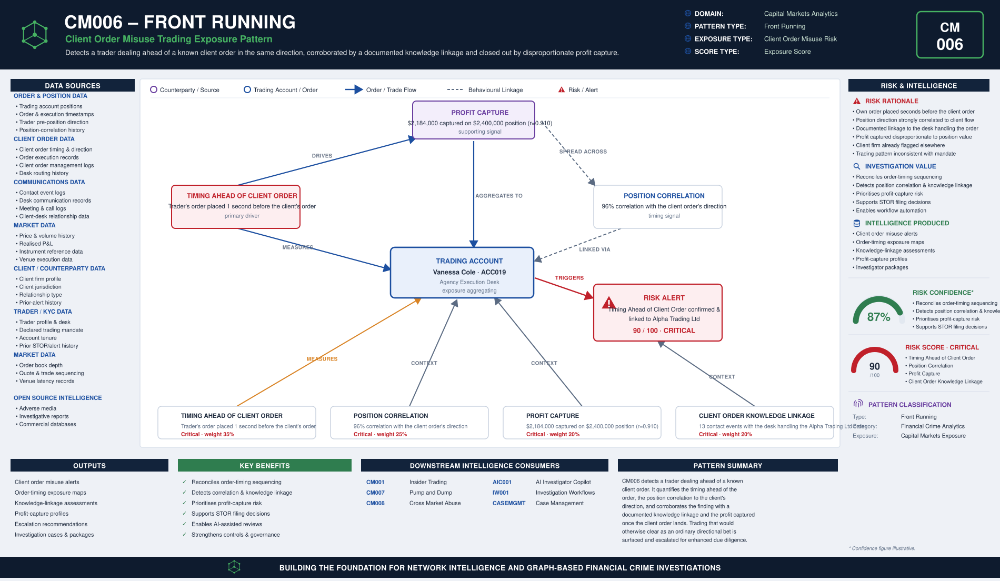

# CM006 – Front Running

## Typology Overview

Front running is a trader dealing on their own account ahead of a client order they
know is coming, positioned in the same direction, then closing out once the client's
order has moved the market. The finding is a convergence finding: it lives in how many
seconds before the client's own order the trader's order was placed, how strongly the
trader's pre-position direction correlates with the client order's direction, how
disproportionate the profit captured is once the client order lands, and whether there
is a documented knowledge linkage between the trader and the desk handling the client
order.

MiFID II Article 16(3) requires firms to maintain effective organisational and
administrative arrangements to prevent conflicts of interest from adversely affecting
clients' interests, and Article 27 requires best execution. Trading ahead of a known
client order — misusing knowledge of client order flow for the trader's own account —
breaches both. Article 8 of the EU Market Abuse Regulation (MAR), which prohibits
dealing on inside information, provides an analogous misuse-of-information framing
applied here to client order flow rather than issuer MNPI. CM006 detects the trading-
side signature of this misuse.

---

# Typology Classification

| Attribute | Value |
|------------|------------|
| Typology ID | CM006 |
| Category | Front Running |
| Risk Domain | Capital Markets Surveillance |
| Primary Threat | Trading ahead of a known client order for personal gain |
| Detection Type | Order-timing & position-correlation analytics |
| Investigation Type | Front Running Investigation |
| Risk Level | High |

---

# Typology Description

Front running seeks to convert advance knowledge of client order flow into trading
profit before the client's own order can move the market, through:

- The trader's own order placed a suspiciously short time before the client's order
- The trader's pre-position direction strongly correlated with the client order's
  direction
- A disproportionate share of the position's value captured as profit once the
  client order lands
- A documented knowledge linkage — contact events between the trader and the desk
  handling the client order in the 90 days before

---

# Typical Routing Structure

```text
Client Firm  (places the client order with the desk)
       │
       ▼
Contact Events  (documented, in the 90 days before the client order)   ← linkage established here
       │
       ▼
Trader's Own Order  (placed seconds ahead of the client order, same direction)
       │
       ▼
Client Order  (executed, moves the market)
       │
       ▼
Profit Captured  (once the client order lands)
```

---

# FC-03 Network Intelligence Dependencies

| FC-03 Component | Purpose |
|------------|------------|
| ER001 Entity Resolution | Resolve the trader, the desk and the client firm |
| RD001 Relationship Discovery | Link the trader to the desk handling the client order |
| NS001 Network Risk Scoring | Aggregate front-running exposure across the trader's connections |
| NI012 Behavioural Pattern Network | Order-timing and contact-clustering behaviour |

---

# Key Risk Indicators

## Timing Ahead of Client Order Indicators
- Trader's own order placed only seconds before the client's order
- Order timing inconsistent with the trader's normal execution cadence
- Repeated pattern of dealing immediately ahead of the same client's flow

## Position Correlation Indicators
- Trader's pre-position direction strongly correlated with the client order's direction
- Position sized and directed inconsistently with the trader's stated mandate
- Position concentrated around a single client's order rather than a market view

## Profit Capture Indicators
- Realised profit disproportionate to the position's value once the client order lands
- Profit timing tightly coupled to the client order's execution
- Position closed out immediately after the client order completes

## Client Order Knowledge Linkage Indicators
- Documented contact events with the desk handling the client order in the 90 days
  before
- Contact frequency inconsistent with the trader's normal coverage relationships
- Trader has access to the client order management system or desk communications

---

# Exposure Scoring Framework

| Risk Category | Weight |
|------------|------------|
| Timing Ahead of Client Order | 35% |
| Position Correlation | 25% |
| Profit Capture | 20% |
| Client Order Knowledge Linkage | 20% |

Band-midpoints 15/45/70/90, weighted sum, half-up, boundary at 80.

## Component Banding Rules

### Timing Ahead of Client Order
`seconds_ahead_of_client_order` REQUIRED — fewer seconds ahead of the client order is
worse.
- ≤ 5 → Critical · ≤ 30 → High · ≤ 120 → Medium · otherwise (> 120) → Low

### Position Correlation
`correlation_pct` (integer 0-100) REQUIRED — correlation between the trader's
pre-position direction and the client order's direction.
- ≤ 40 → Low · ≤ 65 → Medium · ≤ 85 → High · otherwise (> 85) → Critical

### Profit Capture
`r = realized_pnl / position_value`. Both amounts REQUIRED.
- r < 0.25 → Low · r < 0.50 → Medium · r < 0.80 → High · otherwise → Critical

### Client Order Knowledge Linkage
`contact_events_90d` REQUIRED — count of documented contact events with the desk
handling the client order in the 90 days before.
- ≤ 2 → Low · ≤ 5 → Medium · ≤ 9 → High · otherwise (≥ 10) → Critical

---

# Example Exposure Score — ACC019 Vanessa Cole

| Component | Evidence | Band |
|------------|----------|------|
| Timing Ahead of Client Order | Trader's own order placed 1 second before the client's order | Critical |
| Position Correlation | 96% correlation between the trader's pre-position and the client order's direction | Critical |
| Profit Capture | $2,184,000 captured on a $2,400,000 position (r = 0.910) | Critical |
| Client Order Knowledge Linkage | 13 contact events with the desk handling Alpha Trading Ltd's order in the 90 days before | Critical |

**Total Exposure Score: 90 / 100 — Critical** (the single highest-scoring account in
the sample data)

### Classification
- 0–29 = Low · 30–59 = Medium · 60–79 = High · 80–100 = Critical

---

# Business Logic

1. Resolve the trader, the desk and the client firm.
2. Compute the timing ahead of the client order (seconds the trader's own order was
   placed before the client's order).
3. Compute the position correlation (correlation between the trader's pre-position
   direction and the client order's direction).
4. Compute the profit capture ratio (realised P&L / position value).
5. Count the documented contact events with the desk handling the client order in the
   90 days before.
6. Score each of the four components against its band cut-lines.
7. Aggregate the weighted exposure score; escalate at or above the threshold.

---

# Detection Workflow

```text
Order & Position Screening
       ↓
Timing Ahead of Client Order Calculation
       ↓
Position Correlation Analysis
       ↓
Profit Capture Assessment
       ↓
Client Order Knowledge Linkage Review
       ↓
Exposure Scoring
       ↓
Investigator Escalation
```

---

# Python Analytics Example

```python
suspect = accounts[
    (accounts["timing_ahead_of_client_order_band"].isin(["High", "Critical"])) &
    (accounts["correlation_pct"] >= 68) &
    (accounts["contact_events_90d"] >= 6)
]
alerts = suspect[suspect["exposure_score"] >= 80]
```

---

# Investigator Outcome

```text
Trader:                Vanessa Cole — ACC019
Desk:                  Agency Execution Desk
Client Firm:           Alpha Trading Ltd
Timing Ahead of Client Order: 1 second before the client's order
Position Correlation:  96%
Client Order Knowledge Linkage: 13 contact events (90d)
Position Value:        $2,400,000 → Profit Captured: $2,184,000 (r = 0.910)
Exposure Score:        90 / 100
Investigation Outcome:  Escalate — trader dealt ahead of the client's own order in the
                         same direction, corroborated by a documented client order
                         knowledge linkage
```

---

# Regulatory Relevance

- MiFID II Article 16(3) — Organisational Requirements & Conflicts of Interest
- MiFID II Article 27 — Best Execution
- EU Market Abuse Regulation (MAR) Article 8 — analogous misuse-of-information framing
  applied to client order flow
- FCA Conduct of Business Sourcebook (COBS 11) — Best Execution & Client Order Handling

---

# Related Typologies

- CM001 Insider Trading
- CM007 Pump and Dump
- CM008 Cross Market Abuse

---

# Strategic Value

CM006 shows how order-timing and position-correlation intelligence defeats client-
order misuse: by quantifying how many seconds ahead of the client order the trader's
own order was placed, how strongly the trader's pre-position direction correlates with
the client order's direction, how disproportionate the profit captured is once the
client order lands, and the documented knowledge linkage between the trader and the
desk handling the order, it surfaces trading that has been deliberately timed to
exploit advance knowledge of client flow and would otherwise clear as an ordinary
directional bet. As a core member of the fc-07 Capital Markets Analytics family, its
file set, scoring convention, and fc-10 wiring pattern mirror CM001's reference
implementation exactly.


