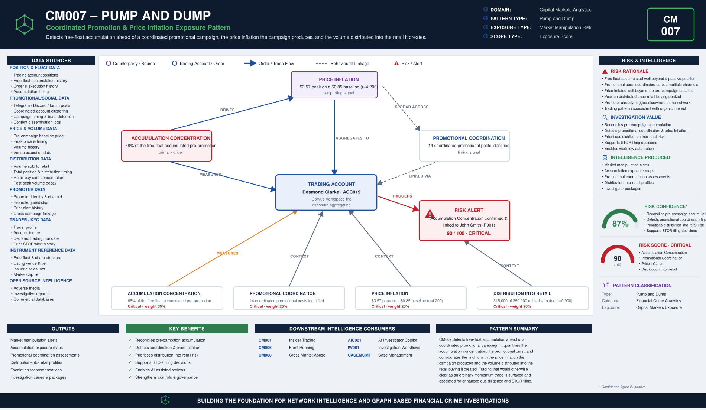

# CM007 – Pump and Dump

## Typology Overview

Pump and dump is coordinated promotion of a thinly-traded, low-float instrument to
inflate its price on false or misleading enthusiasm, followed by distribution of the
promoter's (and colluding accounts') position into the retail buying the promotion
creates. The finding is a convergence finding: it lives in how concentrated the
account's pre-promotion accumulation of the free float is, how large the burst of
coordinated promotional activity around the campaign is, how far the peak price runs
beyond the instrument's baseline, and how much of the position is distributed into
retail once the price is inflated.

Article 12(1)(a) and 12(2)(a) of the EU Market Abuse Regulation (MAR) prohibit
transactions or orders to trade combined with the dissemination of false or misleading
information. Article 12(1)(c) prohibits securing a dominant position over the supply
of or demand for a financial instrument combined with distortive effects on its price.
CM007 detects the trading-side signature of both.

---

# Typology Classification

| Attribute | Value |
|------------|------------|
| Typology ID | CM007 |
| Category | Pump and Dump |
| Risk Domain | Capital Markets Surveillance |
| Primary Threat | Coordinated price inflation and retail distribution |
| Detection Type | Accumulation & promotional-coordination analytics |
| Investigation Type | Market Manipulation Investigation |
| Risk Level | High |

---

# Typology Description

Pump and dump seeks to convert a manufactured price spike into distribution profit
before the market can correct, through:

- A concentrated pre-promotion accumulation of the instrument's free float
- A burst of coordinated promotional posts, messages or accounts around the campaign
- A price peak materially above the instrument's pre-campaign baseline
- Distribution of the position into the retail buying the promotion creates, once the
  price is inflated

---

# Typical Routing Structure

```text
Promoter  (channel operator / campaign coordinator)
       │
       ▼
Coordinated Promotional Posts  (Telegram / Discord / forum / newsletter burst)   ← coordination established here
       │
       ▼
Trading Account  (free float accumulated well beyond a passive position, ahead of the campaign)
       │
       ▼
Price Peak  (inflated well beyond the pre-campaign baseline)
       │
       ▼
Volume Distributed to Retail  (once the price is inflated)
```

---

# FC-03 Network Intelligence Dependencies

| FC-03 Component | Purpose |
|------------|------------|
| ER001 Entity Resolution | Resolve the trader, the instrument and the promoter |
| RD001 Relationship Discovery | Link the trader to the promoter and the promotional channel |
| NS001 Network Risk Scoring | Aggregate pump-and-dump exposure across the promoter's connections |
| NI012 Behavioural Pattern Network | Accumulation and promotional-coordination clustering behaviour |

---

# Key Risk Indicators

## Accumulation Concentration Indicators
- Free-float share accumulated materially larger than a passive market position
- Accumulation concentrated in a single thinly-traded instrument ahead of promotion
- Position built quietly, ahead of any public promotional activity

## Promotional Coordination Indicators
- Burst of coordinated posts, messages or accounts around a single campaign
- Promotional content inconsistent with the instrument's public disclosures
- Coordination frequency inconsistent with organic retail interest

## Price Inflation Indicators
- Peak price materially above the instrument's pre-campaign baseline
- Price spike timed tightly to the promotional burst
- Price action inconsistent with any underlying corporate news

## Distribution Into Retail Indicators
- Volume distributed into retail disproportionate to the account's total position
- Distribution timing tightly coupled to the peak of the promotional campaign
- Retail buying concentrated in the window the price is inflated

---

# Exposure Scoring Framework

| Risk Category | Weight |
|------------|------------|
| Accumulation Concentration | 35% |
| Promotional Coordination | 25% |
| Price Inflation | 20% |
| Distribution Into Retail | 20% |

Band-midpoints 15/45/70/90, weighted sum, half-up, boundary at 80.

## Component Banding Rules

### Accumulation Concentration
`pct_of_float_accumulated` REQUIRED — share of the free float accumulated pre-promotion.
- ≤ 10 → Low · ≤ 25 → Medium · ≤ 45 → High · otherwise (> 45) → Critical

### Promotional Coordination
`coordinated_posts_count` REQUIRED — count of coordinated promotional posts/messages/
accounts identified.
- ≤ 2 → Low · ≤ 5 → Medium · ≤ 9 → High · otherwise (≥ 10) → Critical

### Price Inflation
`r = price_peak / price_baseline`. Both amounts REQUIRED, `price_baseline` > 0.
- r < 1.3 → Low · r < 1.8 → Medium · r < 3.0 → High · otherwise → Critical

### Distribution Into Retail
`r = volume_sold_to_retail / total_position`. Both amounts REQUIRED, `total_position` > 0.
- r < 0.25 → Low · r < 0.50 → Medium · r < 0.80 → High · otherwise → Critical

---

# Example Exposure Score — ACC019 Desmond Vellummote

| Component | Evidence | Band |
|------------|----------|------|
| Accumulation Concentration | 68% of the free float accumulated pre-promotion | Critical |
| Promotional Coordination | 14 coordinated promotional posts identified around the campaign | Critical |
| Price Inflation | Peak $3.57 against a $0.85 baseline (r = 4.200) | Critical |
| Distribution Into Retail | 315,000 of 350,000 units distributed to retail (r = 0.900) | Critical |

**Total Exposure Score: 90 / 100 — Critical** (the single highest-scoring account in
the sample data)

Promoter: **John Cloverspindle** (promoter_id `P001`), the network's PEP — persons never
name-merge under canonical resolution the way companies do, so the stable local id is
what carries the fusion bridge, not the promoter's name alone.

### Classification
- 0–29 = Low · 30–59 = Medium · 60–79 = High · 80–100 = Critical

---

# Business Logic

1. Resolve the trader, the instrument and the promoter.
2. Compute the accumulation concentration (share of the free float accumulated pre-promotion).
3. Count the coordinated promotional posts/messages/accounts identified around the campaign.
4. Compute the price inflation ratio (peak price / pre-campaign baseline price).
5. Compute the distribution into retail ratio (volume sold to retail / total position).
6. Score each of the four components against its band cut-lines.
7. Aggregate the weighted exposure score; escalate at or above the threshold.

---

# Detection Workflow

```text
Position & Float Screening
       ↓
Accumulation Concentration Calculation
       ↓
Promotional Coordination Analysis
       ↓
Price Inflation Review
       ↓
Distribution Into Retail Assessment
       ↓
Exposure Scoring
       ↓
Investigator Escalation
```

---

# Python Analytics Example

```python
suspect = accounts[
    (accounts["accumulation_concentration_band"].isin(["High", "Critical"])) &
    (accounts["coordinated_posts_count"] >= 6) &
    (accounts["price_peak"] / accounts["price_baseline"] >= 1.8)
]
alerts = suspect[suspect["exposure_score"] >= 80]
```

---

# Investigator Outcome

```text
Trader:                Desmond Vellummote — ACC019
Instrument:             Corvus Aerospace Inc
Free Float Accumulated: 68% (Critical), pre-promotion
Promotional Coordination: 14 coordinated posts identified
Price Baseline / Peak:  $0.85 → $3.57 (r = 4.200)
Total Position:         350,000 units → Distributed to Retail: 315,000 units (r = 0.900)
Promoter:                John Cloverspindle (promoter_id P001) — network PEP
Exposure Score:         90 / 100
Investigation Outcome:  Escalate — free float accumulated ahead of a coordinated
                         promotional campaign, price inflated well beyond baseline,
                         and the position distributed into the retail buying created
```

---

# Regulatory Relevance

- EU Market Abuse Regulation (MAR) Article 12(1)(a) and 12(2)(a) — Transactions/orders
  combined with the dissemination of false or misleading information
- EU Market Abuse Regulation (MAR) Article 12(1)(c) — Securing a dominant position
  combined with distortive effects
- FCA Market Conduct Sourcebook (MAR 1) — UK market manipulation provisions

---

# Related Typologies

- CM001 Insider Trading
- CM006 Front Running
- CM008 Cross Market Abuse

---

# Strategic Value

CM007 shows how accumulation-concentration and promotional-coordination intelligence
defeats manufactured-enthusiasm manipulation: by quantifying the free float accumulated
ahead of a campaign, the coordinated promotional activity around it, the price
inflation the campaign produces, and the volume distributed into the retail buying it
creates, it surfaces trading that would otherwise clear as an ordinary momentum trade.
It fuses directly onto the estate's known PEP network — the promoter behind ACC019 is
John Cloverspindle, carried on the stable local id P001 rather than a name-merge, since persons
never resolve the way companies do — extending the fc-07 Capital Markets family's
coverage from information-advantage trading (CM001) into manufactured-price trading.


