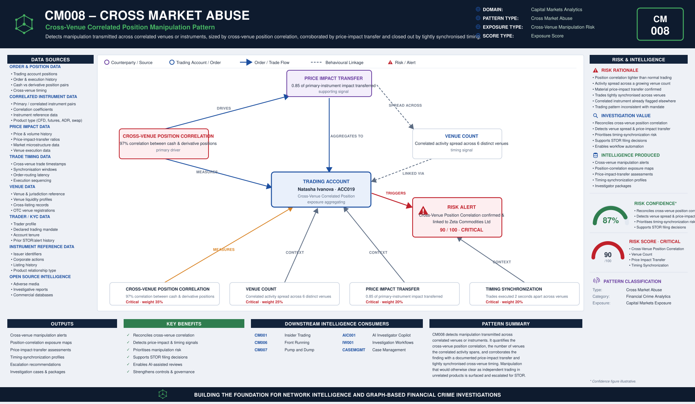

# CM008 – Cross Market Abuse

## Typology Overview

Cross market abuse exploits the link between an account's cash position and a
correlated derivative — or a position that spans multiple trading venues — using a
trade on one leg to move the price of the other. The finding is a convergence
finding: it lives in how tightly the account's cash and derivative (or cross-venue)
positions correlate, how many distinct venues or instruments the correlated activity
spans, how much of the price impact on the primary instrument transfers to the
correlated instrument, and how tightly synchronised the trades across venues are in
time — the tighter the synchronisation, the more deliberate the pattern.

Article 12(1)(c) of the EU Market Abuse Regulation (MAR) prohibits manipulation that
transmits false or misleading signals through trading in one instrument or venue in
order to affect the price of a related instrument on another venue or in another
product (cash vs derivative). CM008 detects the trading-side signature of that
transmission.

---

# Typology Classification

| Attribute | Value |
|------------|------------|
| Typology ID | CM008 |
| Category | Cross Market Abuse |
| Risk Domain | Capital Markets Surveillance |
| Primary Threat | Manipulation transmitted across correlated venues or instruments |
| Detection Type | Cross-venue correlation & price-impact-transfer analytics |
| Investigation Type | Cross Market Abuse Investigation |
| Risk Level | High |

---

# Typology Description

Cross market abuse seeks to move the price of one instrument or venue by trading a
correlated instrument on another, through:

- A cross-venue position correlation materially tighter than would occur by chance
  between the account's cash and derivative (or cross-venue) positions
- Activity spread across a growing number of distinct venues or instruments
- A documented price-impact transfer — how much of the price move on the primary
  instrument shows up on the correlated instrument
- Trades across venues synchronised to a tight time window, closing the loop

---

# Typical Routing Structure

```text
Primary Instrument  (cash equity, listed venue)
       │
       ▼
Correlated Instrument  (derivative, CFD, ADR, swap or cross-listed shares)   ← correlation established here
       │
       ▼
Trading Account  (position correlated across venues, spread over several instruments)
       │
       ▼
Price Impact  (moves on the primary instrument transfer to the correlated instrument)
       │
       ▼
Synchronised Execution  (trades across venues within a tight time window)
```

---

# FC-03 Network Intelligence Dependencies

| FC-03 Component | Purpose |
|------------|------------|
| ER001 Entity Resolution | Resolve the trader, the issuer and the correlated-venue counterparties |
| RD001 Relationship Discovery | Link the trading account to the issuer across venues and instruments |
| NS001 Network Risk Scoring | Aggregate cross-market-abuse exposure across the trader's connections |
| NI012 Behavioural Pattern Network | Cross-venue timing and correlation clustering behaviour |

---

# Key Risk Indicators

## Cross-Venue Position Correlation Indicators
- Correlation between cash and derivative (or cross-venue) positions materially
  tighter than the account's normal trading pattern
- Correlated positions concentrated in a single issuer or a small instrument basket
- Position direction consistent across venues, inconsistent with independent trading

## Venue Count Indicators
- Correlated activity spread across a growing number of distinct venues or instruments
- New venues added to the pattern shortly before a price-sensitive move
- Venue mix spanning cash, listed derivatives and OTC products

## Price Impact Transfer Indicators
- A material share of the price impact on the primary instrument showing up on the
  correlated instrument
- Price-impact transfer disproportionate to the correlated instrument's normal
  liquidity or trading volume

## Timing Synchronization Indicators
- Trades across venues clustered within a tight time window
- Order timing inconsistent with the account's normal cross-venue trading cadence

---

# Exposure Scoring Framework

| Risk Category | Weight |
|------------|------------|
| Cross-Venue Position Correlation | 35% |
| Venue Count | 25% |
| Price Impact Transfer | 20% |
| Timing Synchronization | 20% |

Band-midpoints 15/45/70/90, weighted sum, half-up, boundary at 80.

## Component Banding Rules

### Cross-Venue Position Correlation
`correlation_pct` REQUIRED — correlation between the account's cash and derivative
(or cross-venue) positions.
- ≤ 40 → Low · ≤ 65 → Medium · ≤ 85 → High · otherwise (> 85) → Critical

### Venue Count
`distinct_venues` REQUIRED — count of distinct venues/instruments the correlated
activity spans.
- ≤ 1 → Low · = 2 → Medium · ≤ 4 → High · otherwise (≥ 5) → Critical

### Price Impact Transfer
`r = impact_transfer_ratio` REQUIRED — how much of the price impact on the primary
instrument transfers to the correlated instrument.
- r < 0.10 → Low · r < 0.30 → Medium · r < 0.60 → High · otherwise → Critical

### Timing Synchronization
`seconds_between_venue_trades` REQUIRED — time between the correlated trades across
venues. Fewer seconds between the trades is worse.
- ≤ 5 → Critical · ≤ 30 → High · ≤ 120 → Medium · otherwise (> 120) → Low

---

# Example Exposure Score — ACC019 Natasha Ivanova

| Component | Evidence | Band |
|------------|----------|------|
| Cross-Venue Position Correlation | 97% correlation between cash and derivative positions | Critical |
| Venue Count | Correlated activity spread across 6 distinct venues | Critical |
| Price Impact Transfer | 0.85 of the primary instrument's price impact transferred to the correlated instrument | Critical |
| Timing Synchronization | Trades executed 2 seconds apart across venues | Critical |

**Total Exposure Score: 90 / 100 — Critical** (the single highest-scoring account in
the sample data)

### Classification
- 0–29 = Low · 30–59 = Medium · 60–79 = High · 80–100 = Critical

---

# Business Logic

1. Resolve the trader, the issuer and the correlated-venue counterparties.
2. Compute the cross-venue position correlation between the account's cash and
   derivative (or cross-venue) positions.
3. Count the distinct venues/instruments the correlated activity spans.
4. Compute the price-impact-transfer ratio (price impact on the correlated instrument
   / price impact on the primary instrument).
5. Compute the timing synchronization (seconds between the correlated trades across
   venues).
6. Score each of the four components against its band cut-lines.
7. Aggregate the weighted exposure score; escalate at or above the threshold.

---

# Detection Workflow

```text
Order & Position Screening
       ↓
Cross-Venue Position Correlation Calculation
       ↓
Venue Count Analysis
       ↓
Price Impact Transfer Review
       ↓
Timing Synchronization Assessment
       ↓
Exposure Scoring
       ↓
Investigator Escalation
```

---

# Python Analytics Example

```python
suspect = accounts[
    (accounts["cross_venue_position_correlation_band"].isin(["High", "Critical"])) &
    (accounts["distinct_venues"] >= 4) &
    (accounts["seconds_between_venue_trades"] <= 30)
]
alerts = suspect[suspect["exposure_score"] >= 80]
```

---

# Investigator Outcome

```text
Trader:                Natasha Ivanova — ACC019
Primary Instrument:    Zeta Commodities Ltd Ordinary Shares
Correlated Instrument: Zeta Commodities Ltd Single-Stock Futures
Cross-Venue Correlation: 97% (r-equivalent Critical)
Venue Count:            6 distinct venues
Price Impact Transfer:  0.85 of primary-instrument impact transferred
Timing Synchronization: 2 seconds between correlated trades
Exposure Score:         90 / 100
Investigation Outcome:  Escalate — correlated cash/derivative positions moved in
                         tandem across venues with price impact transferring and
                         trades tightly synchronised in time
```

---

# Regulatory Relevance

- EU Market Abuse Regulation (MAR) Article 12(1)(c) — Manipulation across trading
  venues or correlated instruments (cash vs derivative)
- EU Market Abuse Regulation (MAR) Annex II — Indicators of manipulative behaviour
- ESMA Guidance on cross-product/cross-venue surveillance
- FCA Market Conduct Sourcebook (MAR 1) — UK market abuse provisions

---

# Related Typologies

- CM001 Insider Trading
- CM006 Front Running
- CM007 Pump and Dump

---

# Strategic Value

CM008 shows how cross-venue correlation and price-impact-transfer intelligence
defeats manipulation that hides behind product complexity: by quantifying the
cross-venue position correlation, the venue count the correlated activity spans, the
price impact that transfers across instruments, and the timing synchronization of the
correlated trades, it surfaces manipulation that would otherwise clear as independent
trading in unrelated products. As part of the fc-07 Capital Markets Analytics family,
its file set, scoring convention, and fc-10 wiring pattern mirror CM001, the reference
typology.


