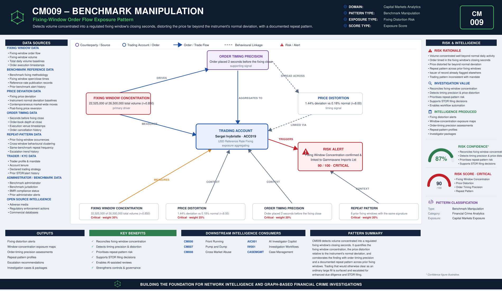

# CM009 – Benchmark Manipulation

## Typology Overview

Benchmark manipulation is the deliberate skewing of a regulated fixing — a reference
rate, an FX fix, a commodity settlement price — through order flow concentrated in the
closing seconds of the fixing window, when there is no longer time for the market to
absorb it. The finding is a convergence finding: it lives in how much of an account's
total daily volume is concentrated inside the fixing window itself, how far the
resulting price deviation runs beyond the instrument's normal deviation for that
window, how close to the window's close the order was placed, and whether the same
account shows a repeat pattern across prior fixing windows.

Article 12(1)(d) of the EU Market Abuse Regulation (MAR) prohibits transmitting false
or misleading information, or securing a price at an abnormal or artificial level, in
relation to a benchmark. CM009 detects the trading-side signature of that manipulation
at the point where it is most visible: concentrated, precisely-timed order flow around
the fixing window's close.

---

# Typology Classification

| Attribute | Value |
|------------|------------|
| Typology ID | CM009 |
| Category | Benchmark Manipulation |
| Risk Domain | Capital Markets Surveillance |
| Primary Threat | Skewing a regulated fixing through window-close order flow |
| Detection Type | Fixing-window concentration & price-distortion analytics |
| Investigation Type | Benchmark Manipulation Investigation |
| Risk Level | High |

---

# Typology Description

Benchmark manipulation seeks to move a regulated fixing away from its fair-value level
by placing volume where it has maximum, unopposed price impact, through:

- A concentration of volume inside the fixing window materially larger than the
  account's normal daily activity would justify
- A price deviation for the fixing window that runs far beyond the instrument's normal
  deviation for that window
- Order timing precision concentrated in the final seconds before the fixing window
  closes, leaving no time for the market to absorb or correct it
- A repeat pattern of the same behaviour across prior fixing windows, showing intent
  rather than a one-off execution artefact

---

# Typical Routing Structure

```text
Trader / Account  (fixing-window order flow)
       │
       ▼
Fixing Window Concentration  (volume concentrated inside the window, not spread across the day)
       │
       ▼
Order Timing Precision  (orders placed in the closing seconds of the window)   ← the pressure point
       │
       ▼
Benchmark Fixing  (SONIA / EURIBOR / WM Reuters / LBMA / ICE / SOFR / Platts / LME)
       │
       ▼
Price Distortion  (fixing price deviates far beyond the instrument's normal deviation)
       │
       ▼
Repeat Pattern  (same account, same behaviour, across prior fixing windows)
```

---

# FC-03 Network Intelligence Dependencies

| FC-03 Component | Purpose |
|------------|------------|
| ER001 Entity Resolution | Resolve the trader, the issuer of record and the benchmark administrator |
| RD001 Relationship Discovery | Link the trading account to the fixing benchmark and the issuer |
| NS001 Network Risk Scoring | Aggregate benchmark-manipulation exposure across the account's connections |
| NI012 Behavioural Pattern Network | Fixing-window timing and repeat-pattern clustering behaviour |

---

# Key Risk Indicators

## Fixing Window Concentration Indicators
- Volume concentrated inside the fixing window materially larger than the account's
  normal daily activity
- Order sizing inconsistent with the account's stated trading mandate
- Concentration clustered around a single benchmark or a small basket of fixings

## Price Distortion Indicators
- Fixing price deviation running far beyond the instrument's normal deviation for that
  window
- Price impact reverting sharply once the fixing window closes
- Distortion inconsistent with contemporaneous market-wide moves

## Order Timing Precision Indicators
- Orders placed in the final seconds before the fixing window's close
- Order timing inconsistent with the account's normal execution cadence
- Timing precision that leaves no window for the market to absorb the flow

## Repeat Pattern Indicators
- Multiple prior fixing windows showing the same concentration-and-timing signature
- Repeat pattern concentrated on the same benchmark or the same issuer
- Escalating repeat frequency without a corresponding change in mandate

---

# Exposure Scoring Framework

| Risk Category | Weight |
|------------|------------|
| Fixing Window Concentration | 35% |
| Price Distortion | 25% |
| Order Timing Precision | 20% |
| Repeat Pattern | 20% |

Band-midpoints 15/45/70/90, weighted sum, half-up, boundary at 80.

## Component Banding Rules

### Fixing Window Concentration
`r = fixing_window_volume / total_daily_volume`. Both amounts REQUIRED.
- r < 0.10 → Low · r < 0.30 → Medium · r < 0.60 → High · otherwise → Critical

### Price Distortion
`r = fixing_price_deviation_pct / normal_deviation_pct`. Both amounts REQUIRED.
- r < 1.5 → Low · r < 3.0 → Medium · r < 6.0 → High · otherwise → Critical

### Order Timing Precision
`seconds_before_fixing_close` REQUIRED — fewer seconds before the close is worse.
- ≤ 5 → Critical · ≤ 20 → High · ≤ 60 → Medium · otherwise (> 60) → Low

### Repeat Pattern
`repeat_occurrences` REQUIRED — count of prior fixing windows showing the same pattern.
- ≤ 1 → Low · = 2 → Medium · ≤ 4 → High · otherwise (≥ 5) → Critical

---

# Example Exposure Score — ACC019 Sergei Ivanov

| Component | Evidence | Band |
|------------|----------|------|
| Fixing Window Concentration | 22,525,000 of 26,500,000 total daily volume (r = 0.850) | Critical |
| Price Distortion | 1.44% fixing deviation vs 0.18% normal deviation (r = 8.00) | Critical |
| Order Timing Precision | Order placed 2 seconds before the fixing window's close | Critical |
| Repeat Pattern | 8 prior fixing windows showing the same pattern | Critical |

**Total Exposure Score: 90 / 100 — Critical** (the single highest-scoring account in
the sample data)

### Classification
- 0–29 = Low · 30–59 = Medium · 60–79 = High · 80–100 = Critical

---

# Business Logic

1. Resolve the trader, the issuer of record and the benchmark administrator.
2. Compute the fixing window concentration ratio (fixing-window volume / total daily volume).
3. Compute the price distortion ratio (fixing price deviation / normal deviation for the window).
4. Measure the order timing precision (seconds before the fixing window's close the order was placed).
5. Count the repeat occurrences of the same pattern across prior fixing windows.
6. Score each of the four components against its band cut-lines.
7. Aggregate the weighted exposure score; escalate at or above the threshold.

---

# Detection Workflow

```text
Fixing Order & Volume Screening
       ↓
Fixing Window Concentration Calculation
       ↓
Price Distortion Analysis
       ↓
Order Timing Precision Review
       ↓
Repeat Pattern Assessment
       ↓
Exposure Scoring
       ↓
Investigator Escalation
```

---

# Python Analytics Example

```python
suspect = orders[
    (orders["fixing_window_concentration_band"].isin(["High", "Critical"])) &
    (orders["seconds_before_fixing_close"] <= 20) &
    (orders["repeat_occurrences"] >= 3)
]
alerts = suspect[suspect["exposure_score"] >= 80]
```

---

# Investigator Outcome

```text
Trader:                Sergei Ivanov — ACC019
Benchmark:              ICE LIBOR-style USD Reference Rate Fixing
Issuer of Record:      Gamma Imports Ltd
Fixing Window Volume:  22,525,000 of 26,500,000 total daily volume (r = 0.850)
Price Distortion:      1.44% fixing deviation vs 0.18% normal (r = 8.00)
Order Timing:          Placed 2 seconds before the fixing window's close
Repeat Pattern:        8 prior fixing windows with the same signature
Exposure Score:        90 / 100
Investigation Outcome:  Escalate — volume concentrated into the fixing window's
                         closing seconds, distorting the price far beyond the
                         instrument's normal deviation, with a documented repeat
                         pattern across prior fixing windows
```

---

# Regulatory Relevance

- EU Market Abuse Regulation (MAR) Article 12(1)(d) — Manipulation of a Benchmark
- EU Benchmarks Regulation (BMR) 2016/1011 — Benchmark Administration & Governance
- EU Market Abuse Regulation (MAR) Annex II — Indicators of Manipulative Behaviour
- FCA Market Conduct Sourcebook (MAR 1) — UK market conduct provisions

---

# Related Typologies

- CM006 Front Running
- CM007 Pump and Dump
- CM008 Cross Market Abuse

---

# Strategic Value

CM009 shows how fixing-window concentration and price-distortion intelligence defeats
close-of-window manipulation: by quantifying the fixing window concentration, the price
distortion relative to the instrument's normal deviation, the order timing precision in
the window's closing seconds, and the repeat pattern across prior fixing windows, it
surfaces trading that has been deliberately timed to move a regulated benchmark and
would otherwise clear as an ordinary large fill. As a member of the fc-07 Capital
Markets Analytics family, its file set, scoring convention, and fc-10 wiring pattern
follow the reference typology (CM001) exactly.


