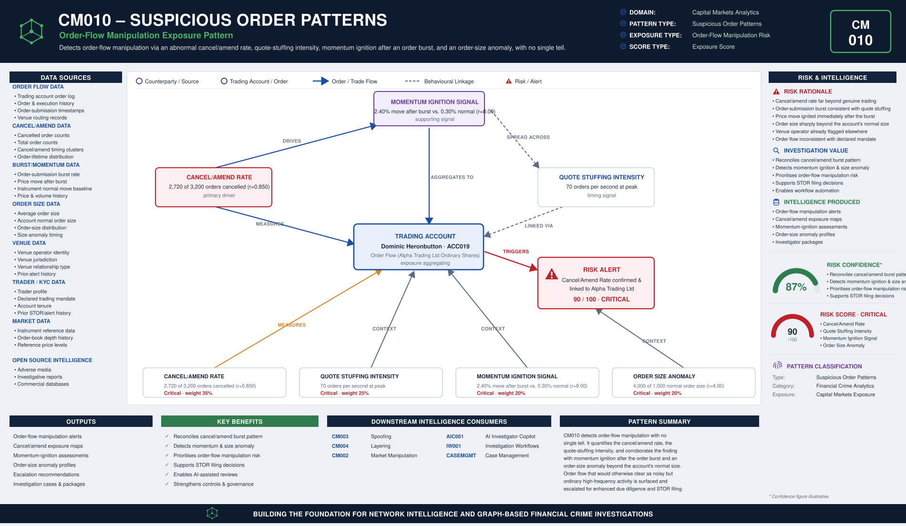

# CM010 – Suspicious Order Patterns

## Typology Overview

Suspicious order patterns are the family's purely order-flow-behavioural typology:
quote stuffing, momentum ignition, and abnormal cancel/amend rates. There is no single
rule that condemns a trading account here — the finding is a convergence finding: it
lives in how abnormal the cancel/amend rate is, how intense the peak order-submission
rate is, how far price moves after an order burst relative to the instrument's normal
move, and how far the average order size departs from the account's normal size.

Article 16 of the EU Market Abuse Regulation (MAR) requires trading venues and firms
to maintain effective arrangements, systems and procedures to detect and report
suspicious orders and transactions. MAR Annex II and the accompanying ESMA Guidelines
on indicators of manipulative behaviour name quote stuffing and momentum ignition
explicitly as indicators of manipulative order-flow behaviour. CM010 operationalises
both.

---

# Typology Classification

| Attribute | Value |
|------------|------------|
| Typology ID | CM010 |
| Category | Suspicious Order Patterns |
| Risk Domain | Capital Markets Surveillance |
| Primary Threat | Order-flow manipulation via quote stuffing and momentum ignition |
| Detection Type | Order-flow burst & anomaly analytics |
| Investigation Type | Market Abuse Investigation |
| Risk Level | High |

---

# Typology Description

Suspicious order patterns seek to distort the order book or ignite a directional price
move through order flow that has no genuine trading intent behind it, through:

- A cancel/amend rate far beyond what genuine trading activity produces — orders
  entered with no intent to execute
- A burst of order-submission intensity consistent with quote stuffing — clogging the
  book to slow down or mislead other participants
- A price move after the order burst well beyond the instrument's normal move —
  momentum ignition, using the burst to trigger a self-reinforcing move
- An average order size well beyond the account's normal size, signalling the burst
  was deliberately amplified rather than an artefact of ordinary market-making

---

# Typical Routing Structure

```text
Trading Account  (order flow behaviour observed at the venue)
       │
       ▼
Order Burst  (cancel/amend rate + quote-stuffing intensity spike)   ← the core signature
       │
       ▼
Price Impact  (momentum ignition — move after the burst vs. normal move)
       │
       ▼
Order Size Anomaly  (average order size vs. the account's normal size)
       │
       ▼
Venue Operator  (execution venue routing and observing the order flow)
```

---

# FC-03 Network Intelligence Dependencies

| FC-03 Component | Purpose |
|------------|------------|
| ER001 Entity Resolution | Resolve the trader, the venue operator and the instrument |
| RD001 Relationship Discovery | Link the trading account to the venue operator and prior alert history |
| NS001 Network Risk Scoring | Aggregate order-flow-abuse exposure across the trader's connections |
| NI012 Behavioural Pattern Network | Order-burst and cancel/amend clustering behaviour |

---

# Key Risk Indicators

## Cancel/Amend Rate Indicators
- Cancel/amend rate far beyond what genuine trading activity produces
- Cancellations clustered in short bursts rather than spread across the session
- Orders entered and withdrawn before any realistic chance of execution

## Quote Stuffing Intensity Indicators
- Peak order-submission rate well beyond the account's normal cadence
- Submission bursts timed around key price levels or reference points
- Order-book depth distorted by high-frequency, low-intent order flow

## Momentum Ignition Signal Indicators
- Price move after the order burst well beyond the instrument's normal move
- Directional move immediately following a cancel/amend or submission spike
- Move not corroborated by underlying news, fundamentals or genuine volume

## Order Size Anomaly Indicators
- Average order size well beyond the account's normal size
- Size anomaly concentrated in the same window as the order burst
- Order sizing inconsistent with the account's declared trading mandate

---

# Exposure Scoring Framework

| Risk Category | Weight |
|------------|------------|
| Cancel/Amend Rate | 35% |
| Quote Stuffing Intensity | 25% |
| Momentum Ignition Signal | 20% |
| Order Size Anomaly | 20% |

Band-midpoints 15/45/70/90, weighted sum, half-up, boundary at 80.

## Component Banding Rules

### Cancel/Amend Rate
`r = cancelled_orders / total_orders`. Both counts REQUIRED.
- r < 0.10 → Low · r < 0.30 → Medium · r < 0.60 → High · otherwise → Critical

### Quote Stuffing Intensity
`orders_per_second` REQUIRED — peak order-submission rate observed.
- ≤ 5 → Low · ≤ 15 → Medium · ≤ 40 → High · otherwise (> 40) → Critical

### Momentum Ignition Signal
`r = price_move_after_burst_pct / normal_move_pct`. Both amounts REQUIRED.
- r < 1.5 → Low · r < 3.0 → Medium · r < 6.0 → High · otherwise → Critical

### Order Size Anomaly
`r = avg_order_size / normal_order_size`. Both amounts REQUIRED.
- r < 1.3 → Low · r < 1.8 → Medium · r < 3.0 → High · otherwise → Critical

---

# Example Exposure Score — ACC019 Dominic Heronbutton

| Component | Evidence | Band |
|------------|----------|------|
| Cancel/Amend Rate | 2,720 of 3,200 orders cancelled (r = 0.850) | Critical |
| Quote Stuffing Intensity | 70 orders per second at peak | Critical |
| Momentum Ignition Signal | 2.40% move after the burst vs. 0.30% normal move (r = 8.00) | Critical |
| Order Size Anomaly | 4,000-unit average order vs. 1,000-unit normal size (r = 4.00) | Critical |

**Total Exposure Score: 90 / 100 — Critical** (the single highest-scoring account in
the sample data)

### Classification
- 0–29 = Low · 30–59 = Medium · 60–79 = High · 80–100 = Critical

---

# Business Logic

1. Resolve the trader, the instrument and the venue operator.
2. Compute the cancel/amend rate (cancelled orders / total orders).
3. Compute the quote stuffing intensity (peak orders per second observed).
4. Compute the momentum ignition ratio (price move after the burst / instrument's normal move).
5. Compute the order size anomaly ratio (average order size / account's normal order size).
6. Score each of the four components against its band cut-lines.
7. Aggregate the weighted exposure score; escalate at or above the threshold.

---

# Detection Workflow

```text
Order & Execution Screening
       ↓
Cancel/Amend Rate Calculation
       ↓
Quote Stuffing Intensity Analysis
       ↓
Momentum Ignition Assessment
       ↓
Order Size Anomaly Review
       ↓
Exposure Scoring
       ↓
Investigator Escalation
```

---

# Python Analytics Example

```python
suspect = order_flow[
    (order_flow["cancel_amend_rate_band"].isin(["High", "Critical"])) &
    (order_flow["orders_per_second"] >= 18) &
    (order_flow["momentum_ignition_signal_band"].isin(["High", "Critical"]))
]
alerts = suspect[suspect["exposure_score"] >= 80]
```

---

# Investigator Outcome

```text
Trader:                Dominic Heronbutton — ACC019
Instrument:             Alpha Trading Ltd Ordinary Shares
Cancelled/Total Orders: 2,720 / 3,200 (r = 0.850)
Peak Order Rate:        70 orders per second
Price Move After Burst: 2.40% vs. 0.30% normal move (r = 8.00)
Average/Normal Order Size: 4,000 / 1,000 units (r = 4.00)
Venue Operator:         Alpha Trading Ltd
Exposure Score:         90 / 100
Investigation Outcome:  Escalate — order-flow burst pattern consistent with quote
                         stuffing and momentum ignition, sized well beyond the
                         account's normal activity
```

---

# Regulatory Relevance

- EU Market Abuse Regulation (MAR) Article 16 — STOR obligation and effective arrangements to detect and report suspicious orders
- EU Market Abuse Regulation (MAR) Annex II / ESMA Guidelines on indicators of manipulative behaviour — quote stuffing and momentum ignition are named indicators
- FCA Market Conduct Sourcebook (MAR 1) — UK market abuse provisions

---

# Related Typologies

- CM003 Spoofing
- CM004 Layering
- CM002 Market Manipulation

---

# Strategic Value

CM010 closes the fc-07 family as its purely behavioural, no-single-signal capstone: by
quantifying the cancel/amend rate, the quote stuffing intensity, the momentum ignition
signal, and the order size anomaly, it surfaces order-flow manipulation that has no
single tell — no one order, cancellation or price move condemns the account on its
own — and would otherwise clear as noisy but ordinary high-frequency activity. As the
family's tenth and final typology, it demonstrates that the same convergence-of-signals
scoring convention that anchors CM001's information-based finding also resolves a
purely mechanical, order-flow-behavioural one, closing the fc-07 Capital Markets
Analytics Toolkit's typology set.


